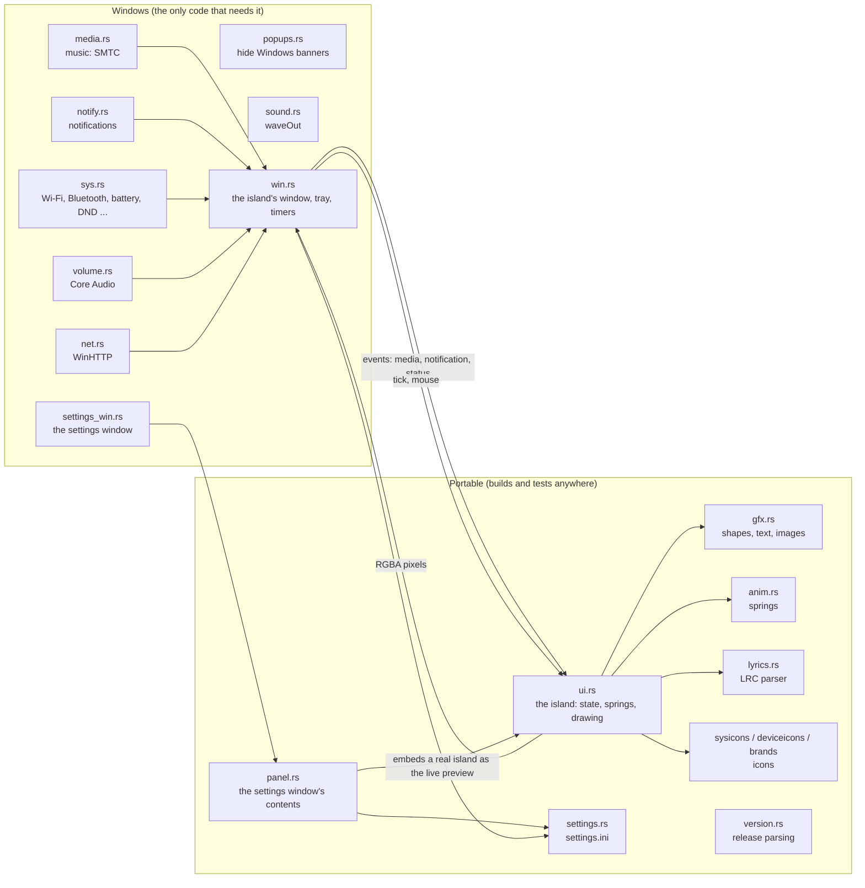

# How Bloop is put together

Bloop has no web engine and no UI toolkit. One rule shapes the code: **everything that looks like something lives in code that does not
know about Windows.** The island, its animations and the settings window are drawn into plain pixel buffers by ordinary Rust, so they
can be rendered to PNG files and tested on any machine. A thin layer of Windows code then puts those pixels on the screen and feeds
the island what is going on (music, notifications, Wi-Fi ...).

## The island (`ui.rs`, `win.rs`)

* `Ui` draws a 470 × 230 logical canvas with [tiny-skia](https://github.com/RazrFalcon/tiny-skia) (CPU, premultiplied RGBA).
  Everything that moves is a spring (`anim.rs`), so it overshoots a little and settles, like on the iPhone.
* `win.rs` owns one layered, topmost, no-activate window with per-pixel alpha. Fully transparent pixels let the mouse through, so
  only the island itself catches the mouse.
* Frame pacing: `Ui::need()` says how often the next frame is wanted: `Rest` (nothing moves, no timer), `Slow` (about 30 fps, for
  an equalizer or a progress bar) or `Fast` (every display refresh, while a spring is moving or karaoke lyrics run). When nothing
  moves, Bloop uses no CPU.
* What is shown is a *mode*: idle, music pill, open player, lyrics, notification card, status pill, or the notch under a maximized
  window. Notifications, status changes and Bluetooth devices queue up and take turns.

## The settings window (`panel.rs`, `settings_win.rs`)

* `Panel` draws the whole window itself (pages, cards, switches, sliders, themes) into a DIB and only returns the rectangles that
  changed. `settings_win.rs` is the Win32 shell around it.
* The top of the window is a **real `Ui`** drawn with the draft settings, which is why the preview always matches what you get.
* Settings are a *draft*: `Panel.s` is edited freely; Save writes `%APPDATA%\DynamicIsland\settings.ini` and tells the running island.

## Where the data comes from

| Thing | Source | File |
|---|---|---|
| Music, cover, position | System Media Transport Controls (what Windows shows in its media overlay) | `media.rs` |
| Notifications | `UserNotificationListener` (Windows asks permission once) | `notify.rs` |
| Wi-Fi, Bluetooth, airplane, hotspot, night light, energy saver, battery, Do Not Disturb | Radios API, registry, power status | `sys.rs` |
| Bluetooth device connected | `DeviceWatcher` | `sys.rs`, `deviceicons.rs` |
| Volume of the music app | Core Audio session of that app (or the master volume) | `volume.rs` |
| Lyrics | lrclib.net, only when you switch lyrics on | `net.rs`, `lyrics.rs` |
| Updates | GitHub Releases API, then the release's `.exe` (checked against its SHA-256 when GitHub gives one) | `update.rs`, `version.rs` |

## Tests and tools

`cargo test --release` runs unit tests and the integration tests in `tests/` (settings window logic, hover behaviour, status pills,
the live preview). Besides the program (`island`), `src/bin/` holds small tools that render things to PNG so the look can be checked
without a Windows machine:

| Tool | What it draws or checks |
|---|---|
| `preview`, `notchview`, `statusview`, `deviceview`, `cardtext`, `cardexit` | the island in its states |
| `lyricstart`, `lyricstyles`, `crossfade`, `preview_lyrics` | the lyrics view |
| `panelview`, `animview` | the settings window and its animations |
| `motion`, `fuzz` | stray-pixel and random-input checks |
| `uibench`, `panelbench` | how long a frame takes |
| `makeicon`, `makesounds`, `sitepics` | build the app icon, the sound files and the website's pictures |

Run one with `cargo run --release --bin <name>`; most write PNGs to the current folder.
