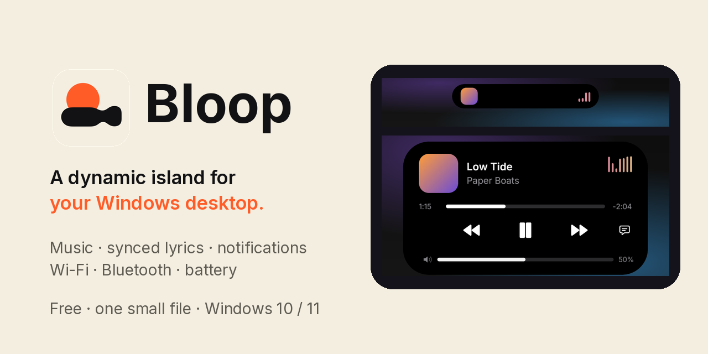
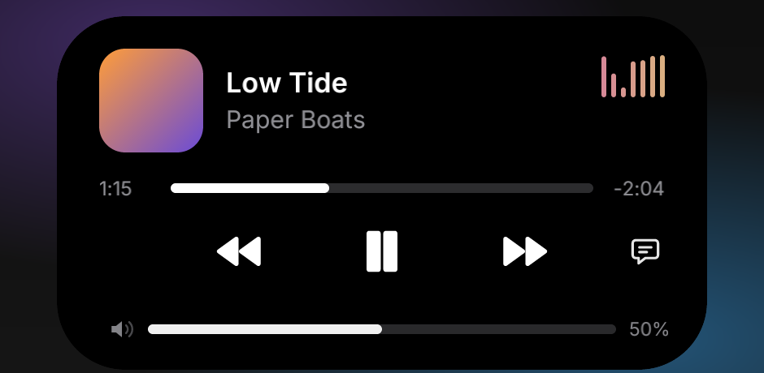
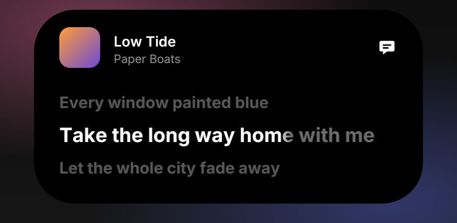
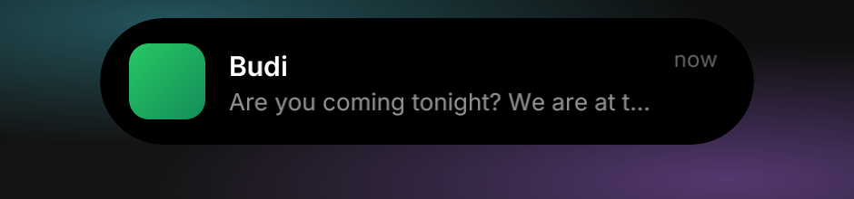
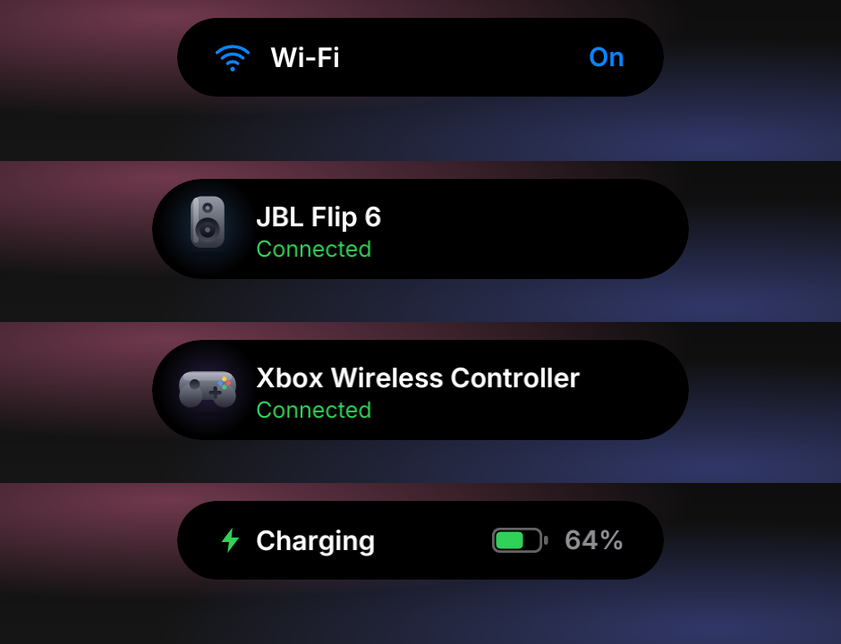
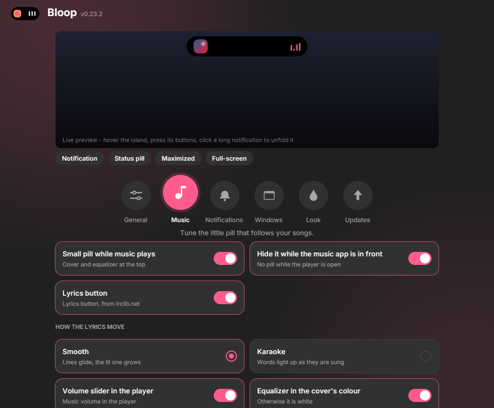

<p align="center">
  
</p>

<h1 align="center">Bloop</h1>

<p align="center">
  A dynamic island for the Windows desktop.<br>
  Music, synced lyrics, notifications and status changes in one small pill at the top of your screen.
</p>

<p align="center">
  <a href="https://github.com/clovr1/bloop/releases/latest/download/Bloop.exe"><b>Download Bloop.exe</b></a>
  &nbsp;·&nbsp;
  <a href="https://clovr1.github.io/bloop/">Website with a live demo</a>
  &nbsp;·&nbsp;
  <a href="CHANGELOG.md">Changelog</a>
</p>

<p align="center">
  
  
  
  <a href="https://github.com/clovr1/bloop/releases/latest"></a>
</p>

---

## What it does

Bloop is a small native program (written in Rust, about 2 MB, no browser engine inside). It draws one transparent
window at the top edge of the screen and everything inside it by itself.

| | |
|---|---|
|  | **Music.** A small pill with the cover and an equalizer while a song plays. Hover to open the player: progress, buttons, volume. It follows whatever Windows shows in its media controls (Spotify, a browser tab, Apple Music ...). |
|  | **Synced lyrics** from [LRCLIB](https://lrclib.net). Two styles: *Smooth*, and *Karaoke* where the words light up as they are sung. |
|  | **Notifications** as a card, or as a small bubble beside the music pill. Click to unfold. Each app keeps its own logo. While Bloop runs, Windows' own pop-ups are hidden so you do not see everything twice. |
|  | **Status pills** for Wi-Fi, Bluetooth, airplane mode, hotspot, night light, energy saver, Do Not Disturb and battery, each with its own soft sound. A Bluetooth speaker, headphones or controller floats in with its own picture. |

More: a **Copied** pill when you copy text, a picture or files (it never shows what was copied), a little **face** in the resting pill that blinks, looks around and smiles, a slim **notch** under maximized windows, the island **tucks away** in full screen (and peeks out when you move the mouse to the
top edge), **six colour themes**, adjustable size and animation speed, and a settings window with a **live preview** where nothing
changes until you press Save.

<p align="center">
  
</p>

## Install

1. Download [`Bloop.exe`](https://github.com/clovr1/bloop/releases/latest/download/Bloop.exe) and open it.
   There is no installer. If Windows SmartScreen warns you ("Windows protected your PC"), click **More info → Run anyway**:
   the program is new and not code-signed.
2. Windows asks once whether Bloop may read your notifications. Allow it, or notifications will not show.
3. Click the tray icon (next to the clock) to open **Settings**. Turn on **Start with Windows** if you like.

To remove it: Settings → General → **Quit Bloop**, then delete the file. Settings live in `%APPDATA%\DynamicIsland`.

Updates: Bloop looks for a newer release on this page's GitHub Releases by itself (Settings → Updates) and offers a restart.

## Privacy

No accounts, no tracking. Bloop talks to the internet in two cases only:

* **lrclib.net**: the title, artist and length of the song, only when you switch lyrics on.
* **github.com**: asking whether a newer version exists (switch it off in Settings → Updates).

## Build from source

You need Rust (stable). On Windows:

```
cargo build --release --bin island
```

The result is `target/release/island.exe`. Everything that does not touch Windows (the look of the island, the settings window,
the lyrics parser) also builds and tests on Linux, which is how most of it is developed:

```
cargo test --release
```

How the code is organised: [ARCHITECTURE.md](ARCHITECTURE.md). How to contribute: [CONTRIBUTING.md](CONTRIBUTING.md).

### Releases

Push a tag such as `v0.23.2`. The workflow in [`.github/workflows/release.yml`](.github/workflows/release.yml) builds `Bloop.exe`
on Windows and attaches it to the release. Installed copies pick it up from there.

### The website

[`docs/`](docs) is a static page for GitHub Pages (Settings → Pages → *Deploy from a branch* → `main` → `/docs`). Its pictures are drawn by the
app itself: `cargo run --release --bin sitepics -- docs/img`.

## Credits

* Lyrics: [LRCLIB](https://lrclib.net).
* Font: [Inter](https://rsms.me/inter/) (SIL Open Font License, see `assets/Inter-LICENSE.txt`).
* Sound effects are synthesised by `src/bin/makesounds.rs`; they are original and only inspired by the feel of system sounds.
* Rendering by [tiny-skia](https://github.com/RazrFalcon/tiny-skia), text by [fontdue](https://github.com/mooman219/fontdue),
  Windows access by the [`windows`](https://github.com/microsoft/windows-rs) crate.
